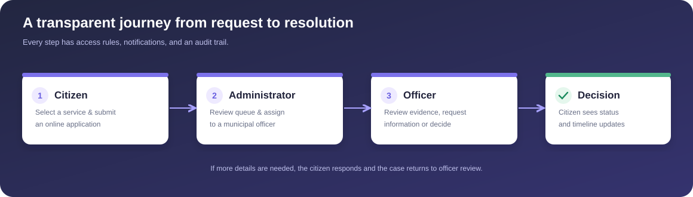
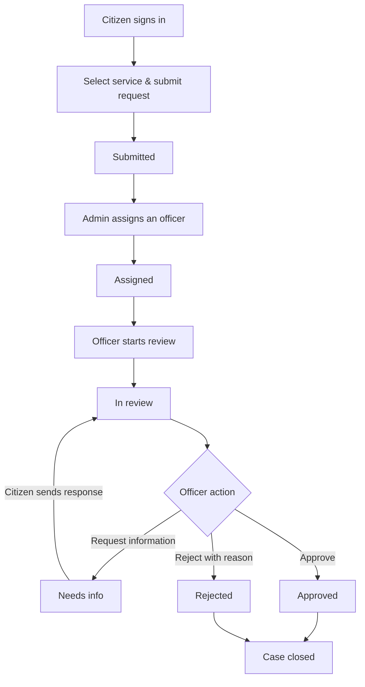
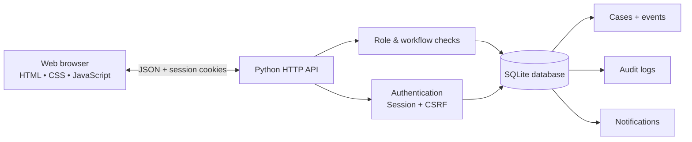

<div align="center">

# 🏛️ CivicServe

**A complete municipal digital-service portal — from application to approval.**

*A full-stack e-governance project with citizen accounts, service requests, officer decisions, an administrator console, case history, audit logs, and in-app notifications.*


**No dependencies. No build step. Just run it.**

</div>

## System overview



A responsive citizen portal and separate role-specific workspaces communicate with one Python JSON API and a transactional SQLite database.

## What it does

| Feature | Citizen | Officer | Administrator |
|---|---:|---:|---:|
| Register and securely sign in | ✅ | ✅* | ✅* |
| Browse eight public services | ✅ | — | — |
| Submit an application | ✅ | — | — |
| See owned/assigned/all applications | Own | Assigned | All |
| Track real case updates & status | ✅ | ✅ | ✅ |
| Request additional information | — | ✅ | — |
| Reply to information request | ✅ | — | — |
| Approve or reject a request | — | ✅ | — |
| Assign and reassign officers | — | — | ✅ |
| Create officer accounts | — | — | ✅ |
| View application and workload stats | Own | Assigned | All |
| Receive in-app notifications | ✅ | ✅ | ✅ |
| Access system audit trail | — | — | ✅ |

\* Officer accounts are created by an admin; an initial admin is seeded in demo mode or bootstrapped via the CLI.

### Eight supported services

Birth certificate, residence certificate, trade license, water connection, property tax correction, streetlight repair, waste collection, and road maintenance.

Each includes a service overview, reference documentation suggestions, and an illustrative service timeline.

## Quick start

Requires **Python 3.10 or newer**. No `pip install` required.

```bash
git clone https://github.com/YOUR_USERNAME/CivicServe.git
cd CivicServe
python app.py
```

Visit **http://127.0.0.1:8000**.

The server initializes a SQLite database automatically and loads realistic demo cases/accounts on first start.

### Demo sign-in

| Account | Email | Password |
|---|---|---|
| Citizen | `citizen@civicserve.local` | `Demo@12345` |
| Officer | `officer@civicserve.local` | `Demo@12345` |
| Second officer | `officer2@civicserve.local` | `Demo@12345` |
| Administrator | `admin@civicserve.local` | `Demo@12345` |

**Security warning:** These credentials are intentionally public and must **never** be used on an Internet-facing deployment. Demo mode is enabled by default for local evaluation only.

### Creating a clean environment

Disable demo seeding, bootstrap your own administrator, then create officers in the dashboard:

```bash
# On macOS/Linux
export CIVICSERVE_DEMO_SEED=0
python manage.py create-admin
python app.py
```

For PowerShell:

```powershell
$env:CIVICSERVE_DEMO_SEED="0"
python manage.py create-admin
python app.py
```

Use a **new empty database** to ensure seeded demo accounts do not remain. Disabling demo seeding does not remove existing accounts.

## Full application workflow



Every meaningful workflow step creates a **case event**, a **system audit entry**, and relevant **in-app notifications**. Approval and rejection are terminal states.

## Project structure

```text
CivicServe/
├── app.py                    # HTTP server, auth, API, workflows
├── manage.py                 # Bootstrap a clean administrator account
├── schema.sql                # Relational database schema and indexes
├── static/
│   ├── index.html            # SPA entry point
│   ├── app.js                # Dashboard, services, forms, cases, timelines
│   ├── style.css             # Responsive design system
│   └── favicon.svg           # CivicServe visual identity
├── tests/
│   └── test_portal.py        # HTTP integration tests
├── docs/assets/             # Screenshots
├── .github/workflows/ci.yml # GitHub Actions tests
├── .gitignore
├── LICENSE
└── README.md
```

### Architecture



**Backend:** Python `http.server`, `sqlite3`, `hashlib`, `hmac`, `secrets`, and other standard-library modules.

**Frontend:** JavaScript hash-based routing, accessible forms, CSS Grid/Flexbox, inline SVG icons, browser `fetch`, and small-screen navigation.

**Database:** SQLite with foreign keys, indexes, and transactional workflow writes.

**Authentication:** PBKDF2-SHA256 salted password hashes (260,000 iterations), opaque random session identifiers stored as SHA-256 hashes, and HTTP-only, SameSite=Strict cookies.

**Authorization:** Each request verifies the user's role and ownership/assignment; hiding controls in the UI is not treated as authorization.

## API overview

| Method | Endpoint | Access |
|---|---|---|
| `GET` | `/api/bootstrap` | Everyone; CSRF token + optional current account |
| `GET` | `/api/health` | Everyone |
| `POST` | `/api/auth/register` | Everyone; always creates citizen |
| `POST` | `/api/auth/login` | Everyone |
| `POST` | `/api/auth/logout` | Signed in |
| `GET` | `/api/services` | Signed in |
| `GET` | `/api/dashboard` | Signed in; scoped by role |
| `GET/POST` | `/api/applications` | Signed in; citizen-only POST |
| `GET` | `/api/applications/:id` | Owner, assigned officer, or admin |
| `POST` | `/api/applications/:id/assign` | Admin |
| `POST` | `/api/applications/:id/transition` | Assigned officer |
| `POST` | `/api/applications/:id/reply` | Applicant, while awaiting info |
| `GET/POST` | `/api/officers` | Admin |
| `GET` | `/api/audit` | Admin |
| `GET` | `/api/notifications` | Signed in |
| `POST` | `/api/notifications/:id/read` | Notification owner |
| `POST` | `/api/notifications/read-all` | Signed in |

Write endpoints accept `application/json` and an `X-CSRF-Token` header obtained from `/api/bootstrap`.

### Example citizen submission

```json
{
  "service_id": 4,
  "subject": "New residential water connection",
  "description": "I recently moved into the property and need a water supply connection.",
  "address": "19 Garden Avenue, Ward 02"
}
```

The response returns a persistent case ID and reference such as `CIV-2026-00011`.

## Run tests

```bash
python -m unittest discover -s tests -v
```

Tests cover login/registration, forced citizen role, session and CSRF protections, ownership restrictions, creation and assignment, state machine rules, the full request-more-information/response/approval cycle, audit records, notifications, and officer provisioning.

GitHub Actions runs tests on push and pull requests.

## Configuration

| Variable | Default | Explanation |
|---|---|---|
| `CIVICSERVE_HOST` | `127.0.0.1` | Local bind address |
| `CIVICSERVE_PORT` | `8000` | HTTP port |
| `CIVICSERVE_DATA_DIR` | `./data` | SQLite directory |
| `CIVICSERVE_DB` | `./data/civicserve.sqlite3` | Override database file |
| `CIVICSERVE_DEMO_SEED` | `1` | Seed demo accounts and example requests |
| `CIVICSERVE_SECURE_COOKIES` | `0` | Set to `1` behind HTTPS (secure cookies) |
| `CIVICSERVE_QUIET` | unset | Set to `1` to hide HTTP request logs |

`python app.py --port 8080` also works.

## What this project demonstrates

- End-to-end public-service request management with a clearly defined status machine.
- Role-based access control **enforced on the server**.
- Case routing, assignment, officer workflows, and user-to-officer feedback loops.
- Event trails, admin audit visibility, and transaction-backed state changes.
- Cleanly designed, responsive user interfaces without heavyweight frontend libraries.
- Testable APIs and automated integration tests, using no external Python packages.

## Scope & safety notes

This is a **portfolio-ready educational prototype**, not an official government website or a certified production system. It runs locally and uses simulated records and in-app notifications (no real email/SMS). It does **not** collect identity documents or process real payments. For public deployment, add a mature production web server, HTTPS/reverse-proxy configuration, rate limiting, account recovery and MFA, stronger session lifecycle controls, centralized tamper-resistant logging, privacy/data-retention policies, backups, accessibility auditing, penetration testing, and appropriate legal review. Do not enter real citizen data in a public demo.

---

<div align="center"><strong>Built to make local service delivery simpler, clearer, and more accountable.</strong></div>
